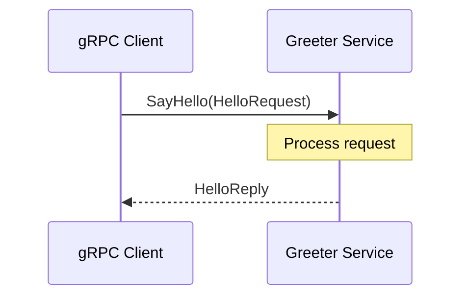

# gRPC Protocol

## 1. Overview

The gRPC communication contract is defined in
`src/main/proto/helloworld.proto`.

The protocol uses Protocol Buffers version 3 (`proto3`) to define
the service interface and the messages exchanged between clients
and the server.

The contract declares a service named `Greeter`, which exposes
a single remote procedure called `SayHello`.

## 2. Protocol Definition

### 2.1 Syntax and Package

The protocol uses the following declaration:

```protobuf
syntax = "proto3";
```

The protocol package is:

```protobuf
package helloworld;
```

The package identifies the service and message namespace within
the Protocol Buffers definition.

### 2.2 Java Code Generation Options

The protocol defines the following Java generation options:

```protobuf
option java_multiple_files = true;
option java_package = "org.frekost.micro.services.greeter";
```

- `java_multiple_files = true` generates separate Java source files
  for the top-level message types instead of placing them all inside
  a single outer Java class.
- `java_package` specifies the Java package used for the generated
  classes.

The generated classes belong to the
`org.frekost.micro.services.greeter` package.

## 3. Greeter Service

The protocol declares the following service:

```protobuf
service Greeter {
  rpc SayHello (HelloRequest) returns (HelloReply) {}
}
```

The `Greeter` service exposes one remote procedure:

| RPC Method | Request Type | Response Type |
|---|---|---|
| `SayHello` | `HelloRequest` | `HelloReply` |

The `SayHello` method accepts a single request and returns a single
response. It is therefore a unary RPC operation rather than a
streaming operation.

The protocol defines the method signature but does not specify
the business logic used to generate the response. That behavior
is implemented by the server-side Java code.

## 4. HelloRequest Message

The request message is defined as follows:

```protobuf
message HelloRequest {
  string name = 1;
}
```

The message contains the following field:

| Field | Type | Field Number | Description |
|---|---|---:|---|
| `name` | `string` | 1 | Name supplied with the greeting request |

The `name` field contains the value provided by the caller.

Under the standard `proto3` scalar-field semantics, an unset
`name` field has the default value of an empty string.

The field number `1` identifies the field in the Protocol Buffers
wire format. It is not an application-level identifier.

The protocol itself does not require the name to be non-empty.
The server implementation validates the value and rejects empty
or whitespace-only names with the gRPC status `INVALID_ARGUMENT`.

## 5. HelloReply Message

The response message is defined as follows:

```protobuf
message HelloReply {
  string message = 1;
}
```

The message contains the following field:

| Field | Type | Field Number | Description |
|---|---|---:|---|
| `message` | `string` | 1 | Text returned by the service |

The `message` field contains the response text returned to the
caller.

The protocol does not prescribe the exact response text. Its
content depends on the implementation of the `SayHello` method.

In the current implementation, a valid name produces a greeting
in the form `Hello, <name>!`.

## 6. RPC Communication Flow

The expected interaction follows this sequence:

1. The client creates a `HelloRequest` message.
2. The client invokes the `Greeter.SayHello` RPC.
3. The server processes the request.
4. The server returns a `HelloReply` message if the request is valid.
5. The client receives the response.

If the name is empty or contains only whitespace, the server
rejects the request with the gRPC status `INVALID_ARGUMENT`.

The following Mermaid sequence diagram illustrates the
successful interaction:



This diagram represents the protocol interaction. The concrete
server startup mechanism, client configuration, and request
processing logic are documented separately based on the
application source code.

## 7. Code Generation

The `GRPCMicroService` Maven build configures the
`protobuf-maven-plugin` to generate Java code from the
Protocol Buffers definition.

The versions of the Protocol Buffers compiler (`protoc`), the
gRPC Java code generator (`protoc-gen-grpc-java`), and the
`protobuf-maven-plugin` are defined in the Maven configuration.
Refer to `pom.xml` for the exact configured versions.

The plugin configuration includes the following goals:

- `compile`: generates Java classes from Protocol Buffers messages.
- `compile-custom`: invokes the configured custom generator to
  generate gRPC-related Java classes.

The generated source files are build artifacts and should not be
edited manually. Changes to the service contract should be made
in `helloworld.proto`, followed by regeneration of the source code
through the Maven build.

## 8. Scope and Limitations

This document describes the protocol contract defined in
`helloworld.proto`.

It does not provide a detailed description of:

- Server startup and gRPC endpoint configuration.
- Client connection settings.
- The implementation of centralized error handling.
- Integration and test behavior.
- Authentication, authorization, or transport security.

These aspects are documented separately in the corresponding
project documentation.