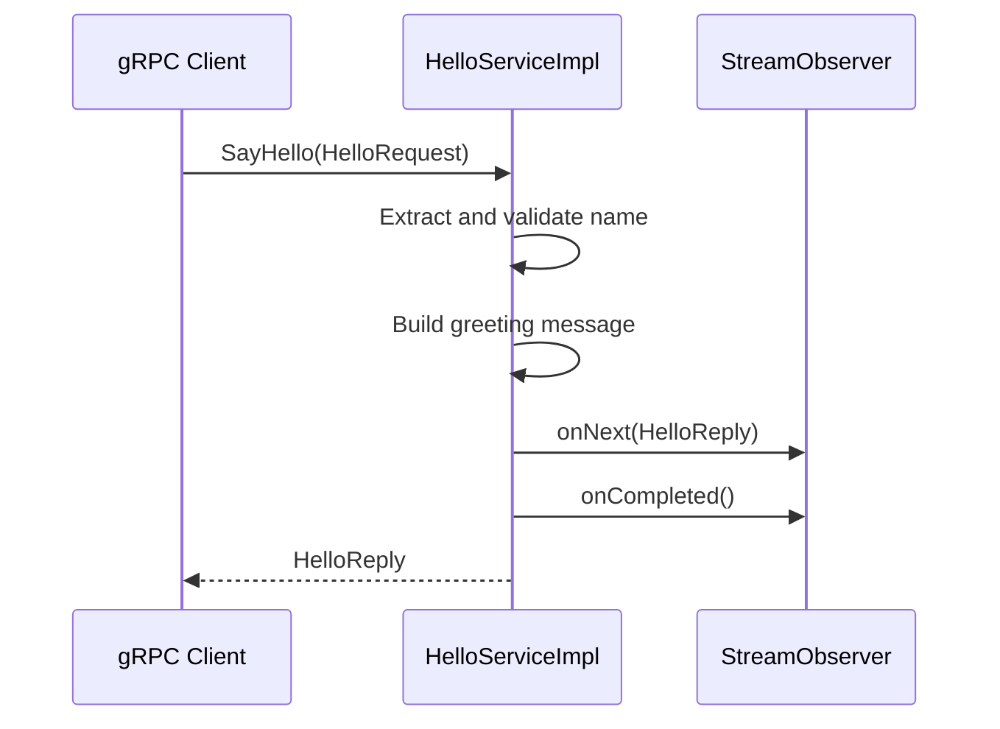

# Greeter Service Implementation

## 1. Overview

The gRPC service implementation is defined in
`src/main/java/org/frekost/micro/services/grpc/greeter/HelloServiceImpl.java`.

The class implements the `Greeter` service defined in
`src/main/proto/helloworld.proto`.

Its main responsibility is to process incoming `SayHello` requests,
validate the supplied name, and return a greeting message to the
client.

The implementation uses Micronaut for service registration and
gRPC for request handling and response delivery.

Invalid requests are rejected by throwing an application-specific
exception, which can be mapped to a gRPC status by the centralized
error-handling infrastructure.

## 2. Package and Dependencies

The implementation belongs to the following Java package:

```java
package org.frekost.micro.services.grpc.greeter;
```

The class uses the following generated gRPC and Protocol Buffers
types:

- `GreeterGrpc`: generated gRPC service definition and base class.
- `HelloRequest`: generated Protocol Buffers request message.
- `HelloReply`: generated Protocol Buffers response message.

It also uses the following framework and application types:

- `StreamObserver`: gRPC interface used to send responses and
  signal completion.
- `@GrpcService`: Micronaut annotation used to register the class
  as a gRPC service.
- `InvalidRequestException`: application exception used when the
  request contains an invalid name.

The generated Java classes are derived from `helloworld.proto`
during the Maven build.

## 3. Service Registration

The class is annotated with:

```java
@GrpcService
```

This annotation allows Micronaut to register the class as a gRPC
service.

The implementation extends the generated base class:

```java
public class HelloServiceImpl extends GreeterGrpc.GreeterImplBase
```

`GreeterImplBase` provides the base implementation for the
operations declared by the `Greeter` service.

The class overrides the `sayHello` method to implement the
application-specific behavior of the corresponding RPC.

## 4. SayHello Method

The service implementation overrides the following method:

```java
@Override
public void sayHello(
        HelloRequest request,
        StreamObserver<HelloReply> responseObserver) {
    // Implementation
}
```

The method receives two arguments:

- `request`: the incoming `HelloRequest` message.
- `responseObserver`: the gRPC observer used to send the response
  and indicate that the RPC has completed.

The method implements a unary RPC. For a valid request, it sends
one response message and then signals completion.

## 5. Request Processing

### 5.1 Extracting the Name

The method retrieves the name from the request:

```java
String name = request.getName();
```

The value comes from the `name` field defined in `HelloRequest`.

Because the Protocol Buffers field is a `string` under `proto3`,
an unset field normally produces an empty string rather than
`null`.

### 5.2 Validating the Name

The implementation checks whether the name is `null` or blank:

```java
if (name == null || name.isBlank()) {
    throw new InvalidRequestException("The name must not be empty");
}
```

The `isBlank()` method detects strings that are empty or contain
only whitespace characters.

If the name is invalid, the service throws an
`InvalidRequestException` instead of generating a greeting.

The centralized gRPC error-handling infrastructure maps this
exception to the `INVALID_ARGUMENT` status.

The service does not substitute a default name such as `world`.

### 5.3 Constructing the Greeting

For a valid name, the service creates the greeting text:

```java
String message = "Hello, " + name + "!";
```

The supplied name is inserted directly into the greeting.

For example, a request containing `Alice` produces:

```text
Hello, Alice!
```

The implementation does not trim or otherwise normalize the
supplied name. A name containing leading or trailing whitespace
is accepted as long as it is not blank.

## 6. Creating and Sending the Response

### 6.1 Building the HelloReply Message

The service creates a Protocol Buffers response object:

```java
HelloReply reply = HelloReply.newBuilder()
        .setMessage(message)
        .build();
```

The builder sets the `message` field to the greeting text and
then creates the response message.

### 6.2 Sending the Response

The response is sent through the gRPC observer:

```java
responseObserver.onNext(reply);
```

The `onNext` call delivers the response message to the gRPC
framework for transmission to the client.

The implementation then signals successful completion:

```java
responseObserver.onCompleted();
```

This indicates that the server has finished sending responses
for the RPC.

For a valid request, the method sends exactly one response message
before completing the call.

## 7. Request Processing Flow

The implementation follows this sequence:

1. Micronaut registers the service through `@GrpcService`.
2. The client invokes the `Greeter.SayHello` RPC.
3. The service extracts the name from the request.
4. The service checks whether the name is empty or blank.
5. If the name is invalid, the service throws
   `InvalidRequestException`.
6. If the name is valid, the service constructs the greeting text.
7. The service creates a `HelloReply` message.
8. The response is sent through `responseObserver.onNext`.
9. The RPC is completed through `responseObserver.onCompleted`.

The following sequence diagram illustrates the successful
request-processing flow:



For an invalid name, the service throws an exception instead
of sending a normal response. The centralized error-handling
infrastructure maps the exception to a gRPC error status.

The gRPC framework handles the actual transport of responses
and errors to the client.

## 8. Error Handling

The service performs input validation by throwing
`InvalidRequestException` when the name is `null` or blank.

The centralized error-handling components are responsible for
mapping supported application exceptions to appropriate gRPC
status codes.

For this validation error, the resulting status is
`INVALID_ARGUMENT`.

The service does not implement this mapping directly. Keeping
exception-to-status conversion in the centralized error-handling
infrastructure separates request processing from error mapping.

The interceptor handles supported synchronous exceptions raised
during request processing. Asynchronous failures and errors
reported directly through `StreamObserver.onError` may require
additional handling in the relevant service implementation.

## 9. Design Considerations and Limitations

The current implementation has the following characteristics:

- It validates the name before constructing the greeting.
- It rejects empty and whitespace-only names.
- It returns a single `HelloReply` for a valid request.
- It uses `StreamObserver` to deliver the response and signal
  successful completion.
- It relies on centralized infrastructure to map supported
  application exceptions to gRPC status codes.
- It does not implement authentication or authorization.
- It does not perform additional normalization of the supplied name.

The implementation does not include custom console output.
Request diagnostics and error logging are handled separately
where configured by the application.

## 10. Summary

`HelloServiceImpl` implements the `Greeter` gRPC service and
provides the application logic for the `SayHello` operation.

Its behavior is straightforward:

- Read the name from the request.
- Reject a `null`, empty, or whitespace-only name.
- Throw `InvalidRequestException` for invalid input.
- Construct a greeting for a valid name.
- Return the greeting in a `HelloReply`.
- Complete the unary RPC.

The service implementation connects the protocol contract defined
in `helloworld.proto` with the runtime behavior of the application.