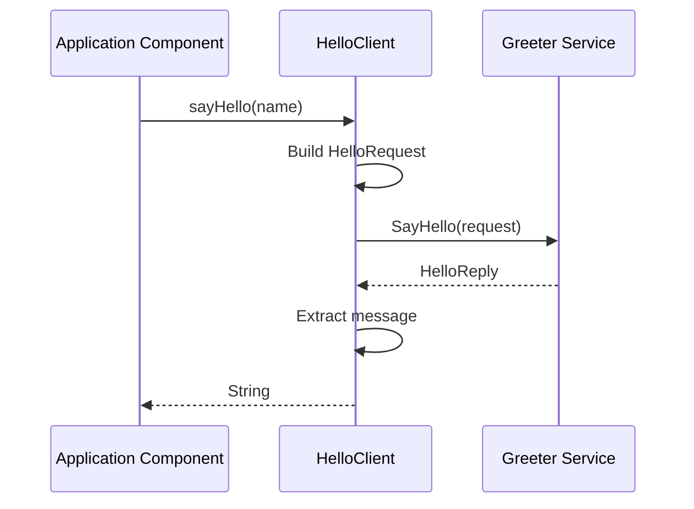

# gRPC Client

## 1. Overview

The client implementation is defined in
`src/main/java/org/frekost/micro/client/HelloClient.java`.

The `HelloClient` class provides a Java interface for invoking
the `Greeter.SayHello` gRPC method.

It uses the generated gRPC client stub and the `greeter` channel
configured in `application.properties`.

Its main responsibilities are:

- Obtain the configured gRPC client channel.
- Create a blocking gRPC stub.
- Build a `HelloRequest` message.
- Invoke the remote `SayHello` method.
- Return the response message as a Java `String`.
- Expose a method for shutting down the channel.

## 2. Package and Dependencies

The class belongs to the following Java package:

```java
package org.frekost.micro.client;
```

It uses the following generated gRPC and Protocol Buffers classes:

- `GreeterGrpc`: generated gRPC service and client stub definitions.
- `HelloRequest`: request message sent to the server.
- `HelloReply`: response message returned by the server.

It also uses the following framework and runtime classes:

- `ManagedChannel`: represents the gRPC client communication channel.
- `@GrpcChannel`: identifies the named gRPC channel to inject.
- `@Inject`: requests dependency injection.
- `@Singleton`: registers the class as a singleton-scoped bean.

## 3. Micronaut Bean Registration

The class is annotated with:

```java
@Singleton
public class HelloClient implements AutoCloseable
```

The `@Singleton` annotation makes `HelloClient` a singleton-scoped
Micronaut bean.

This allows other components managed by Micronaut to obtain the
client through dependency injection.

The class implements `AutoCloseable` and provides a `close()`
method that initiates shutdown of its gRPC channel.

Implementing `AutoCloseable` does not, by itself, determine when
the method is called. The lifecycle management of the bean and
the channel should be considered separately.

## 4. Channel Injection

The constructor receives a `ManagedChannel`:

```java
@Inject
public HelloClient(@GrpcChannel("greeter") ManagedChannel channel) {
    this.blockingStub = GreeterGrpc.newBlockingStub(channel);
    this.channel = channel;
}
```

The `@GrpcChannel("greeter")` annotation identifies the configured
channel named `greeter`.

In `application.properties`, this channel is configured with:

```properties
grpc.channels.greeter.plaintext=true
grpc.channels.greeter.address=localhost:50052
```

The client therefore uses the channel configured to target
`localhost:50052` with plaintext communication.

The constructor stores the channel reference and creates a
blocking stub from it.

## 5. Blocking Stub

The class declares the following field:

```java
private final GreeterGrpc.GreeterBlockingStub blockingStub;
```

The stub is created using:

```java
GreeterGrpc.newBlockingStub(channel)
```

A blocking stub provides synchronous RPC invocation.

When a method is called on the stub, the calling thread waits
for the RPC to complete or fail before the call returns.

This differs from asynchronous invocation, where callbacks
or other asynchronous mechanisms are used to handle the result.

## 6. SayHello Method

The client exposes the following method:

```java
public String sayHello(String name)
```

It accepts a Java `String` containing the name to send to the
remote service and returns the response text as a `String`.

### 6.1 Building the Request

The method creates a request message:

```java
HelloRequest request = HelloRequest.newBuilder()
        .setName(name)
        .build();
```

The supplied name is assigned to the `name` field of
`HelloRequest`.

The resulting message is used as the input to the RPC.

The client does not validate the name before creating the request.
Validation is performed by the server implementation.

### 6.2 Invoking the RPC

The client invokes the remote method:

```java
HelloReply reply = blockingStub.sayHello(request);
```

This calls the `SayHello` operation defined by the `Greeter`
service.

Because the client uses a blocking stub, the call waits for the
response or for the RPC to fail.

The method does not explicitly catch or translate gRPC exceptions.
Failures can therefore propagate to the caller as runtime
exceptions, such as `StatusRuntimeException`.

### 6.3 Returning the Response

After receiving the response, the client returns its message:

```java
return reply.getMessage();
```

The caller receives the value of the `message` field from
`HelloReply`, rather than the complete Protocol Buffers response
object.

For example, if the server returns `Hello, Alice!`, the method
returns that text as a Java `String`.

## 7. Channel Shutdown

The class implements the following `close()` method:

```java
@Override
public void close() {
    if (channel != null && !channel.isShutdown()) {
        channel.shutdown();
    }
}
```

The method checks that the channel reference is not `null` and
that the channel has not already entered the shutdown state.

If both conditions are satisfied, it calls `channel.shutdown()`.

This initiates an orderly shutdown of the channel. The method
does not wait for termination to complete.

The class exposes this operation through `AutoCloseable`, but
the actual point at which `close()` is invoked depends on how
the client bean and its injected channel are managed.

Because the channel is injected by Micronaut, its lifecycle
should be considered before shutting it down explicitly.
Other components may depend on the same configured channel.

## 8. Request-Response Flow

The client operation follows this sequence:

1. A caller invokes `HelloClient.sayHello(name)`.
2. The client creates a `HelloRequest`.
3. The blocking stub invokes `Greeter.SayHello`.
4. The server validates and processes the request.
5. If the request is valid, the server returns a `HelloReply`.
6. The client extracts the response's `message` field.
7. The method returns the resulting Java `String`.

If the server rejects the request or the RPC otherwise fails,
the call can throw an exception instead of returning a greeting.

The following sequence diagram illustrates the successful
request-response interaction:



The diagram shows the logical request-response interaction.
The actual network transport is handled by gRPC.

## 9. Implementation Notes

### 9.1 Synchronous Execution

The use of `GreeterBlockingStub` makes the client API synchronous.

The calling thread remains blocked until the RPC returns or
fails. This behavior should be considered when invoking the
client from latency-sensitive or event-loop threads.

### 9.2 Error Handling

The `sayHello` method does not implement explicit exception
handling.

If the RPC fails, the exception may propagate to the caller.
Callers that need to recover from communication failures should
handle the relevant gRPC exceptions at an appropriate level.

For example, a caller can inspect the status carried by a
`StatusRuntimeException` to distinguish invalid requests from
other RPC failures.

### 9.3 Channel Ownership

The channel is injected by Micronaut through `@GrpcChannel`.

The class also exposes a `close()` method that initiates channel
shutdown. The ownership and lifecycle responsibilities for an
injected channel should be clearly defined to avoid unintended
interference with other components that might use the same channel.

### 9.4 Manual Channel Construction

The source file may contain a commented-out constructor that
creates a channel directly from a host and port.

If present, that constructor is not part of the active implementation.
The active constructor relies on Micronaut dependency injection
and the configured `greeter` channel.

## 10. Summary

`HelloClient` provides a synchronous Java interface to the
`Greeter.SayHello` gRPC method.

It obtains the configured `greeter` channel through dependency
injection, creates a blocking stub, sends a `HelloRequest`,
and returns the response message as a string.

The class also exposes a channel shutdown operation through
its `AutoCloseable` implementation.

Request validation and server-side error mapping are handled
by the service and the centralized gRPC error-handling
infrastructure.