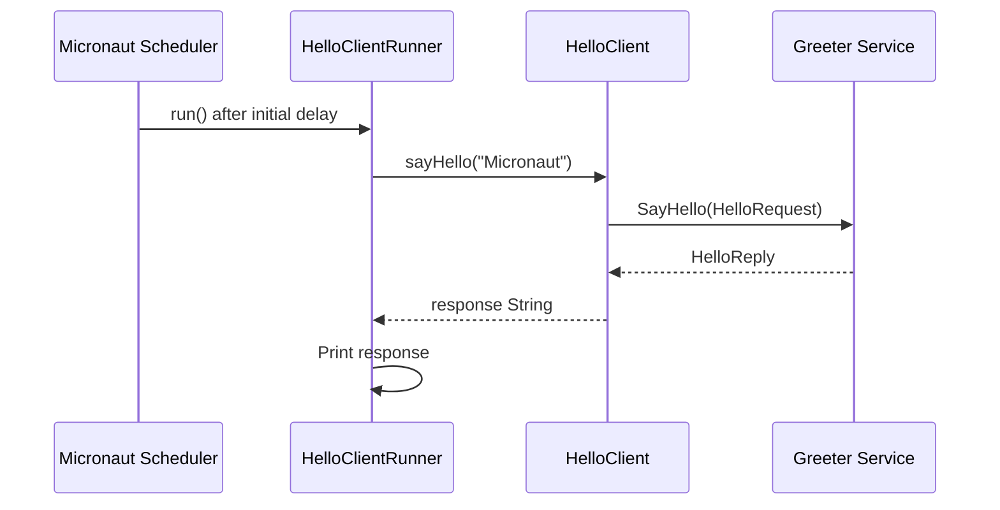

# gRPC Client Runner

## 1. Overview

The client runner is implemented in
`src/main/java/org/frekost/micro/client/HelloClientRunner.java`.

Its purpose is to trigger a gRPC request after the Micronaut
application starts and report the result to the console.

The runner delegates the actual RPC invocation to `HelloClient`.

Its main responsibilities are:

- Obtain the `HelloClient` bean through dependency injection.
- Schedule the `run()` method with an initial delay of three seconds.
- Invoke the remote greeting service with the name `Micronaut`.
- Print the response returned by the server.
- Report failures to standard error.

## 2. Bean Registration

The class is annotated with:

```java
@Singleton
public class HelloClientRunner
```

The `@Singleton` annotation registers the class as a singleton-scoped
Micronaut bean.

This allows Micronaut to manage the component and inject its
dependencies.

## 3. Dependency Injection

The runner declares a reference to `HelloClient`:

```java
private final HelloClient helloClient;
```

The dependency is supplied through the constructor:

```java
public HelloClientRunner(HelloClient helloClient) {
    this.helloClient = helloClient;
}
```

This constructor-based dependency injection separates the
scheduling logic from the gRPC communication logic.

The runner decides when to invoke the client, while `HelloClient`
handles request creation, RPC invocation, and response extraction.

## 4. Scheduled Execution

The `run()` method is annotated with:

```java
@Scheduled(initialDelay = "3s")
```

The `initialDelay` parameter specifies a delay of three seconds
before the scheduled method is first executed.

The method does not declare a `fixedDelay` or `fixedRate`
parameter. Therefore, the source code does not explicitly define
a recurring execution interval.

The actual execution also depends on Micronaut's scheduling
infrastructure being enabled and available.

## 5. Invoking the gRPC Client

The runner calls the client with a fixed name:

```java
String response = helloClient.sayHello("Micronaut");
```

The string `Micronaut` is passed to `HelloClient.sayHello()`.

The client constructs a `HelloRequest`, invokes the
`Greeter.SayHello` RPC through its blocking stub, and returns
the `message` field from the resulting `HelloReply`.

The runner stores the returned text in the `response` variable.

## 6. Handling the Result

When the RPC completes successfully, the runner prints:

```java
System.out.println("Response from gRPC server: " + response);
```

For the current server implementation, the expected response
for the name `Micronaut` is:

```text
Hello, Micronaut!
```

Consequently, the console output should resemble:

```text
Response from gRPC server: Hello, Micronaut!
```

This output depends on the server being reachable and the RPC
completing successfully.

## 7. Exception Handling

The client invocation is enclosed in a `try`/`catch` block:

```java
try {
    String response = helloClient.sayHello("Micronaut");
    System.out.println("Response from gRPC server: " + response);
} catch (Exception e) {
    System.err.println("gRPC call failed: " + e.getMessage());
}
```

If an exception occurs during the invocation or while processing
the result, the runner catches it and prints an error message
to standard error.

The output includes the exception message but does not print
the full stack trace.

The exception is handled within the runner and is not rethrown
by this method.

## 8. Execution Flow

The runner follows this sequence:

1. Micronaut creates the `HelloClientRunner` bean.
2. The `HelloClient` dependency is injected through the constructor.
3. The scheduler waits for the configured initial delay.
4. The scheduler invokes `run()`.
5. The runner calls `helloClient.sayHello("Micronaut")`.
6. The client sends a request to the gRPC server.
7. The runner prints the response or reports an exception.

The following sequence diagram illustrates the successful
interaction:



If the client invocation throws an exception, the runner prints
an error message instead of the successful response message.

## 9. Configuration and Runtime Dependencies

The runner relies on the following components:

- Micronaut bean management to create the runner and inject `HelloClient`.
- Micronaut scheduling infrastructure to execute the scheduled method.
- The `greeter` gRPC client channel configured in
  `application.properties`.
- The gRPC server implementing the `Greeter` service.

The runner itself does not configure the network address or
transport security. Those settings are defined in the application
configuration and consumed by the gRPC client integration.

## 10. Summary

`HelloClientRunner` triggers a greeting request through `HelloClient`
after an initial delay of three seconds.

It sends the fixed name `Micronaut`, prints the server's response
on success, and reports failures to standard error.

The class connects Micronaut's scheduling mechanism with the
application's gRPC client implementation.