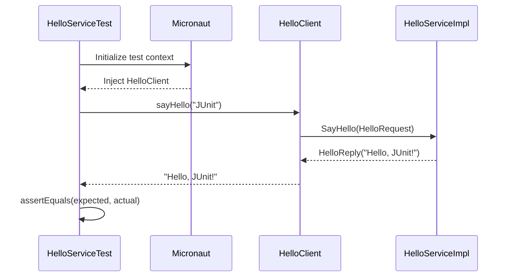
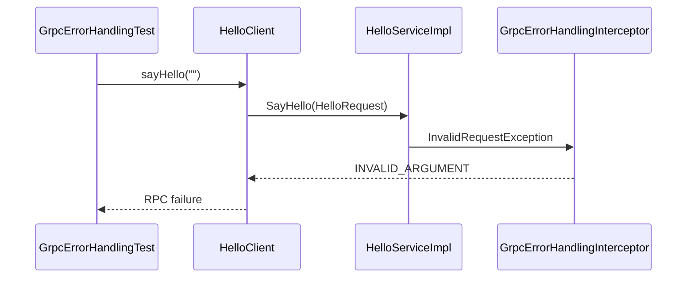

# Testing the gRPC Service

## 1. Overview

The project includes tests for the gRPC greeting service and its
error-handling behavior.

The tests use Micronaut's JUnit 5 testing integration and exercise
the service through the application-managed gRPC client.

The test classes are located in:

- `src/test/java/org/frekost/test/micro/HelloServiceTest.java`
- `src/test/java/org/frekost/test/micro/GrpcErrorHandlingTest.java`

The tests cover the successful greeting flow and the handling of
invalid request values.

## 2. Test Framework

The tests use the following annotations and components:

- `@MicronautTest`: initializes the Micronaut application context
  for testing.
- `@Inject`: injects application-managed beans into the test class.
- `@Test`: marks methods for execution by JUnit 5.
- `Assertions`: provides assertions for verifying test results.

The tests rely on Micronaut dependency injection and the application's
gRPC client configuration rather than manually constructing the
client or its channel.

## 3. Testing the Successful Greeting

### Source file

`src/test/java/org/frekost/test/micro/HelloServiceTest.java`

The `HelloServiceTest` class verifies that a valid name produces
the expected greeting.

The test injects the `HelloClient` bean:

```java
@Inject
HelloClient client;
```

The test method is:

```java
@Test
public void testSayHello() {
    String resp = client.sayHello("JUnit");
    Assertions.assertEquals("Hello, JUnit!", resp);
}
```

The test performs two operations:

1. Calls `client.sayHello("JUnit")`.
2. Checks that the returned string is exactly `"Hello, JUnit!"`.

If the actual response differs from the expected value, JUnit
reports the assertion as failed.

This test verifies the successful client-to-service interaction
for the input `"JUnit"`.

## 4. Testing gRPC Error Handling

### Source file

`src/test/java/org/frekost/test/micro/GrpcErrorHandlingTest.java`

The `GrpcErrorHandlingTest` class checks the service's behavior
when it receives invalid input and verifies that a subsequent
valid request can still succeed.

The service rejects names that are empty or contain only whitespace.
In these cases, `HelloServiceImpl` throws an `InvalidRequestException`,
which the gRPC error-handling interceptor maps to the
`INVALID_ARGUMENT` status.

The error-handling tests cover the following scenarios:

- A valid name produces the expected greeting.
- An empty name is rejected.
- A whitespace-only name is rejected.
- A name containing spaces but also non-whitespace characters
  is accepted.
- A valid request succeeds after an invalid request.

These cases help verify both input validation and the centralized
mapping of supported exceptions to gRPC status codes.

The expected gRPC status for an empty or whitespace-only name is:

```text
INVALID_ARGUMENT
```

The associated error description is:

```text
The name must not be empty
```

The exact assertions and test structure are defined in
`GrpcErrorHandlingTest.java`.

## 5. Execution Flow

The general execution flow for a successful integration test is:

1. Micronaut initializes the test application context.
2. The `HelloClient` bean is injected into the test.
3. The test calls `client.sayHello()` with a name.
4. The client builds a `HelloRequest`.
5. The request is sent through the configured `greeter` channel.
6. The `Greeter` service processes the request.
7. The client returns the message contained in the `HelloReply`.
8. The test compares the actual response with the expected value.

For an invalid request, the service raises an exception and the
error-handling interceptor maps it to the appropriate gRPC status.
The client observes the failed RPC rather than receiving a normal
greeting response.

## 6. Successful Request Sequence

The following sequence diagram illustrates the successful
interaction tested by `HelloServiceTest`:



## 7. Error Handling Sequence

For an invalid name, the request follows a different path:



The diagram represents the intended error-handling path for
the synchronous exception raised by the service.

## 8. What the Tests Verify

Together, the test classes cover the following behavior:

| Scenario | Expected behavior |
|---|---|
| Valid name such as `"JUnit"` | Returns `"Hello, JUnit!"` |
| Empty name | RPC fails with `INVALID_ARGUMENT` |
| Whitespace-only name | RPC fails with `INVALID_ARGUMENT` |
| Name containing spaces and non-whitespace characters | Request is accepted |
| Valid request after an invalid request | The valid request succeeds |

The tests provide integration-level coverage of the configured
client-to-service path and the supported synchronous error-handling
behavior.

They do not, by themselves, establish that every possible failure
mode is handled. For example, additional tests would be needed to
verify behavior when the server is unavailable, when a request
times out, or when an unexpected asynchronous failure occurs.

## 9. Running the Tests

From the `GRPCMicroService` project directory, run:

```bash
mvn test
```

To run only the successful greeting test:

```bash
mvn -Dtest=HelloServiceTest test
```

To run only the error-handling tests:

```bash
mvn -Dtest=GrpcErrorHandlingTest test
```

To run the project's full Maven verification lifecycle, including
compilation and verification checks, use:

```bash
mvn clean compile verify
```

The tests require the project's dependencies and test configuration
to be available.

## 10. Summary

The project's tests verify both the normal gRPC greeting flow and
selected error-handling scenarios.

`HelloServiceTest` checks that a valid request returns the expected
greeting. `GrpcErrorHandlingTest` checks invalid input handling,
the resulting `INVALID_ARGUMENT` status, and successful processing
of a valid request after an invalid one.

Together, these tests provide a foundation for validating the
gRPC service implementation and its centralized exception handling.