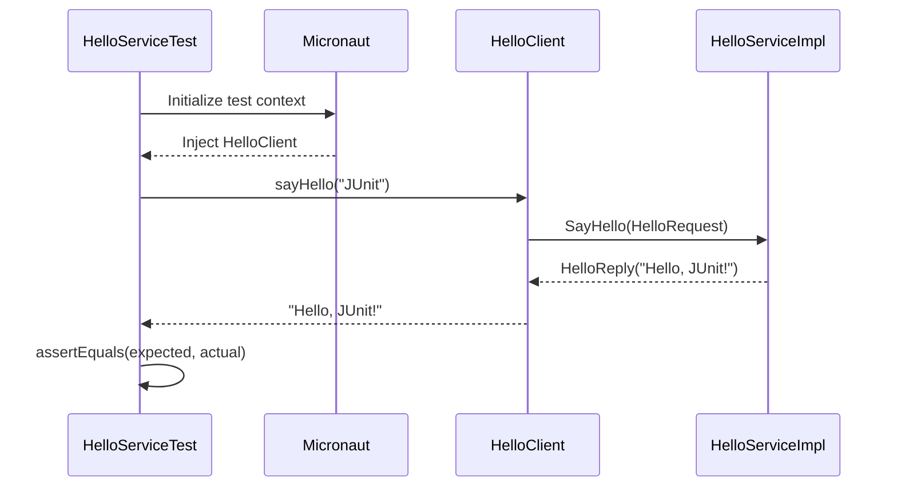
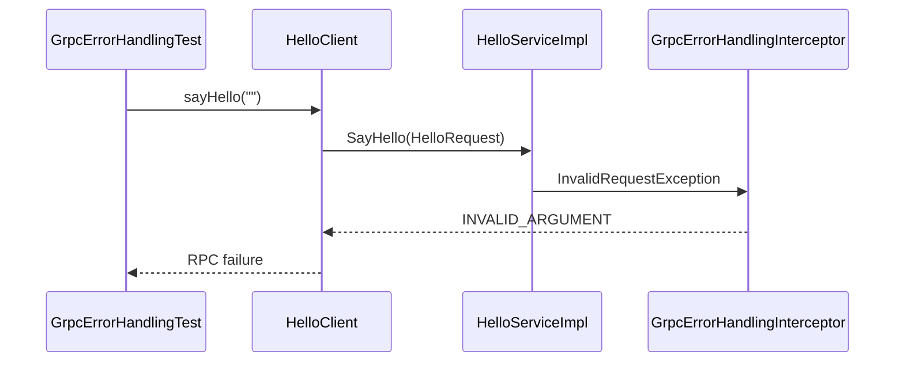

# Testing the gRPC Service

## 1. Overview

The project includes tests for the gRPC greeting service, its error-handling behavior, and the gRPC logging interceptor.

The tests use Micronaut's JUnit 5 testing integration where applicable and exercise the service through the application-managed gRPC client. The logging interceptor also has dedicated tests for its call-handling behavior.

The test classes are located in:

- `src/test/java/org/frekost/test/micro/HelloServiceTest.java`
- `src/test/java/org/frekost/test/micro/error/GrpcErrorHandlingTest.java`
- `src/test/java/org/frekost/test/micro/logging/GrpcLoggingInterceptorTest.java`

The tests cover the successful greeting flow, selected invalid request values, and selected behaviors of the logging interceptor.

## 2. Test Framework

The tests use the following annotations and components where applicable:

- `@MicronautTest`: initializes the Micronaut application context for integration testing.
- `@Inject`: injects application-managed beans into the test class.
- `@Test`: marks methods for execution by JUnit 5.
- `Assertions`: provides assertions for verifying test results.

The service tests rely on Micronaut dependency injection and the application's gRPC client configuration rather than manually constructing the client or its channel.

The logging interceptor tests focus on the interceptor's behavior when processing gRPC server calls.

## 3. Testing the Successful Greeting

### Source file

`src/test/java/org/frekost/test/micro/HelloServiceTest.java`

The `HelloServiceTest` class verifies that a valid name produces the expected greeting.

The test injects the `HelloClient` bean:

```java
@Inject
HelloClient client;
```

The test method is:

```java
@Test
public void testSayHello() {
    String resp = client.sayHello("JUnit");
    Assertions.assertEquals("Hello, JUnit!", resp);
}
```

The test performs two operations:

1. Calls `client.sayHello("JUnit")`.
2. Checks that the returned string is exactly `"Hello, JUnit!"`.

If the actual response differs from the expected value, JUnit reports the assertion as failed.

This test verifies the successful client-to-service interaction for the input `"JUnit"`.

## 4. Testing gRPC Error Handling

### Source file

`src/test/java/org/frekost/test/micro/error/GrpcErrorHandlingTest.java`

The `GrpcErrorHandlingTest` class checks the service's behavior when it receives invalid input and verifies that a subsequent valid request can still succeed.

The service rejects names that are empty or contain only whitespace. In these cases, `HelloServiceImpl` throws an `InvalidRequestException`, which the gRPC error-handling interceptor maps to the `INVALID_ARGUMENT` status.

The error-handling tests cover the following scenarios:

- A valid name produces the expected greeting.
- An empty name is rejected.
- A whitespace-only name is rejected.
- A name containing spaces but also non-whitespace characters is accepted.
- A valid request succeeds after an invalid request.

These cases help verify input validation and the centralized mapping of supported exceptions to gRPC status codes.

The expected gRPC status for an empty or whitespace-only name is:

```text
INVALID_ARGUMENT
```

The associated error description is:

```text
The name must not be empty
```

The exact assertions and test structure are defined in `GrpcErrorHandlingTest.java`.

## 5. Testing the gRPC Logging Interceptor

### Source file

`src/test/java/org/frekost/test/micro/logging/GrpcLoggingInterceptorTest.java`

The `GrpcLoggingInterceptorTest` class contains tests for the behavior of `GrpcLoggingInterceptor`.

The interceptor is responsible for recording the start and completion of gRPC server calls, including the final status and elapsed time.

The test class covers the following scenarios:

- A call completes successfully.
- A call completes with a non-OK gRPC status.
- A synchronous exception is raised while starting a server call.

These tests help verify how the interceptor handles successful calls, failed calls, and synchronous exceptions during call startup.

The logging interceptor uses SLF4J. The project uses SLF4J Simple as its logging backend.

The interceptor records call metadata such as the gRPC method name, completion status, and duration. It does not log request or response payloads.

The dedicated interceptor tests do not, by themselves, prove that the interceptor is registered and active in every Micronaut application configuration. That behavior should be verified separately when validating application integration.

## 6. Execution Flow

The general execution flow for a successful integration test is:

1. Micronaut initializes the test application context.
2. The `HelloClient` bean is injected into the test.
3. The test calls `client.sayHello()` with a name.
4. The client builds a `HelloRequest`.
5. The request is sent through the configured `greeter` channel.
6. The `Greeter` service processes the request.
7. The client returns the message contained in the `HelloReply`.
8. The test compares the actual response with the expected value.

For an invalid request, the service raises an exception and the error-handling interceptor maps it to the appropriate gRPC status. The client observes the failed RPC rather than receiving a normal greeting response.

When the logging interceptor is active, it also records the start and completion of the server call. The completion log includes the final gRPC status and elapsed time.

## 7. Successful Request Sequence

The following sequence diagram illustrates the successful interaction tested by `HelloServiceTest`:



## 8. Error Handling Sequence

For an invalid name, the request follows a different path:



The diagram represents the intended error-handling path for the synchronous exception raised by the service.

## 9. What the Tests Verify

Together, the test classes cover the following behavior:

| Test class | Scenario | Expected behavior |
|---|---|---|
| `HelloServiceTest` | Valid name such as `"JUnit"` | Returns `"Hello, JUnit!"` |
| `GrpcErrorHandlingTest` | Empty name | RPC fails with `INVALID_ARGUMENT` |
| `GrpcErrorHandlingTest` | Whitespace-only name | RPC fails with `INVALID_ARGUMENT` |
| `GrpcErrorHandlingTest` | Name containing spaces and non-whitespace characters | Request is accepted |
| `GrpcErrorHandlingTest` | Valid request after an invalid request | The valid request succeeds |
| `GrpcLoggingInterceptorTest` | Successful server call | Tests the interceptor's handling of a successful call |
| `GrpcLoggingInterceptorTest` | Non-OK server status | Tests the interceptor's handling of a failed call |
| `GrpcLoggingInterceptorTest` | Synchronous exception during call startup | Tests the interceptor's exception-handling behavior |

The service tests provide integration-level coverage of the configured client-to-service path and selected synchronous error-handling behavior.

The logging tests focus on the interceptor's behavior when processing server calls. They should not be interpreted as proof that all logging configuration, application registration, or runtime logging output has been tested.

Additional tests would be needed to verify behavior when the server is unavailable, when a request times out, or when an unexpected asynchronous failure occurs.

## 10. Running the Tests

Run the commands below from the `GRPCMicroService` project directory.

### Run all tests

```bash
mvn test
```

### Run the successful greeting test

```bash
mvn -Dtest=HelloServiceTest test
```

### Run the error-handling tests

```bash
mvn -Dtest=GrpcErrorHandlingTest test
```

### Run the logging interceptor tests

```bash
mvn -Dtest=GrpcLoggingInterceptorTest test
```

### Run the full Maven verification lifecycle

```bash
mvn clean compile verify
```

The full verification command performs the Maven lifecycle phases needed to compile the project, execute its configured tests, and run applicable verification checks.

The tests require the project's dependencies and test configuration to be available.

## 11. Summary

The project's tests verify the normal gRPC greeting flow, selected error-handling scenarios, and selected behaviors of the logging interceptor.

`HelloServiceTest` checks that a valid request returns the expected greeting.

`GrpcErrorHandlingTest` checks invalid input handling, the resulting `INVALID_ARGUMENT` status, and successful processing of a valid request after an invalid one.

`GrpcLoggingInterceptorTest` checks the interceptor's handling of successful calls, non-OK statuses, and synchronous exceptions during call startup.

Together, these tests provide a foundation for validating the gRPC service implementation, centralized exception handling, and logging interceptor behavior.